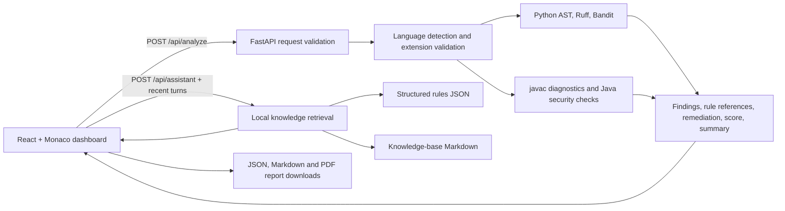

# Application Architecture

## Scope

The application is a local-first static review dashboard for Python and Java. It
does not execute submitted source, persist source code or review history, or
call an external model. The assistant uses deterministic local keyword
retrieval over the secure coding rules and Markdown knowledge base, then
returns grounded guidance and references; it does not use a vector database or
LLM.

## Components and data flow

### Responsibilities

- **Frontend:** accepts pasted/uploaded source, detects or lets the user select a
  language, manages loading/errors, displays actual findings, and downloads
  reports. Source is sent only to the configured local backend for analysis.
- **API:** validates payload shape, file name, language, and the 100 KB source
  limit. It coordinates Python/Java analysis, adds rule references, attaches
  per-finding remediation examples, computes normalized severity counts, health
  score and review status, and returns structured JSON.
- **Language detection:** prefers `.py`/`.java` filename extensions, otherwise
  scores syntax patterns. Ambiguous input is rejected instead of guessed.
- **Python analyzer:** parses with `ast`, then runs configured Ruff and Bandit
  subprocesses with argument arrays, fixed timeouts, and temporary files.
- **Java analyzer:** optionally compiles in a temporary directory with
  annotation processing disabled and adds supported static security checks.
  Java compilation does not run the submitted class.
- **Knowledge base:** loads `knowledge-base/security-rules.json` and Markdown
  reference documents. Retrieval is local lexical keyword matching and includes
  source references. Recent conversation turns provide context for follow-up
  questions; no embeddings, external API, or fabricated source is used.
- **Reports:** the frontend exports JSON and Markdown; the backend generates
  PDF. Exports include findings, recommendations and corrected examples but
  omit submitted source lines and the suggested full-source buffer to reduce
  accidental secret disclosure.

## API endpoints

| Method | Endpoint | Request | Response |
| --- | --- | --- | --- |
| `GET` | `/api/health` | — | `{"status":"ok","service":"ai-code-review-agent"}` |
| `POST` | `/api/analyze` | `{"code":"...","language":"python","filename":"main.py"}`; language and filename may be omitted when source detection is unambiguous | language, filename, findings with remediation, counts, tool status, suggested code, score, PR summary, timestamp |
| `POST` | `/api/knowledge/search` | `{"query":"SQL injection","language":"python","limit":5}` | locally matched structured rules and document chunks |
| `POST` | `/api/assistant` | question, optional language/finding, and up to 8 recent `{question, answer}` turns | grounded local answer, retrieval mode, context-used flag, source references |
| `POST` | `/api/report` | same body as `/api/analyze` | downloadable JSON report without submitted source or suggested full source |
| `POST` | `/api/report/pdf` | same body as `/api/analyze` | downloadable PDF review report |
| `GET` | `/docs` | — | FastAPI OpenAPI documentation |

All JSON request models reject unknown fields. Source and question content have
explicit length limits. The assistant accepts finding metadata and bounded
conversation context, but not the submitted source. Analysis results are held
in the current frontend session and are not persisted by the backend.

## Finding shape and severity

Findings preserve the existing `line`, `type`, `severity`, `title`,
`explanation`, and `recommended_fix` properties, and include a report-local
`finding_id`, `category`, `language`, and `filename`. Security findings receive
`rule_id` and `guidance` metadata when a catalog rule can be matched. Tool
severity labels (`error`, `warning`, `high`, etc.) remain intact for API/UI
compatibility. Each finding also includes remediation details, a source-line
snippet, a corrected example when a safe example is available, and explanations
of the problem and fix. The PR summary includes normalized severity counts,
health score, security and quality summaries, prioritized corrections, and
Approved / Changes Requested / Needs Review status.

## Remediation and report behavior

Rule-specific examples cover supported finding patterns such as hardcoded
secrets, SQL injection, dynamic execution, shell invocation and unsafe
deserialization. Examples are not automatically applied and may require
adaptation to the database driver or application. For diagnostics where a safe
rewrite cannot be inferred, the API reports that limitation rather than
inventing a correction. The PDF report contains metadata, normalized severity
counts, findings, corrections and examples, but not submitted source code.

The existing code-analysis and security analyzers remain the source of findings;
remediation and PR-summary steps consume those actual results. The assistant
retrieves applicable content from local rules and docs and uses recent
client-supplied turns for follow-up context. These modules are deterministic
and local; they do not call independent LLM agents.

## Security and operational boundaries

- Submitted code is parsed, linted, scanned, or compiled; it is never executed.
- Temporary analyzer files are removed when each analysis call finishes.
- Tool invocations use explicit argument lists and timeouts.
- No submitted source or review history is saved by the backend.
- Static checks cover supported patterns only and do not guarantee that code is
  vulnerability-free.
