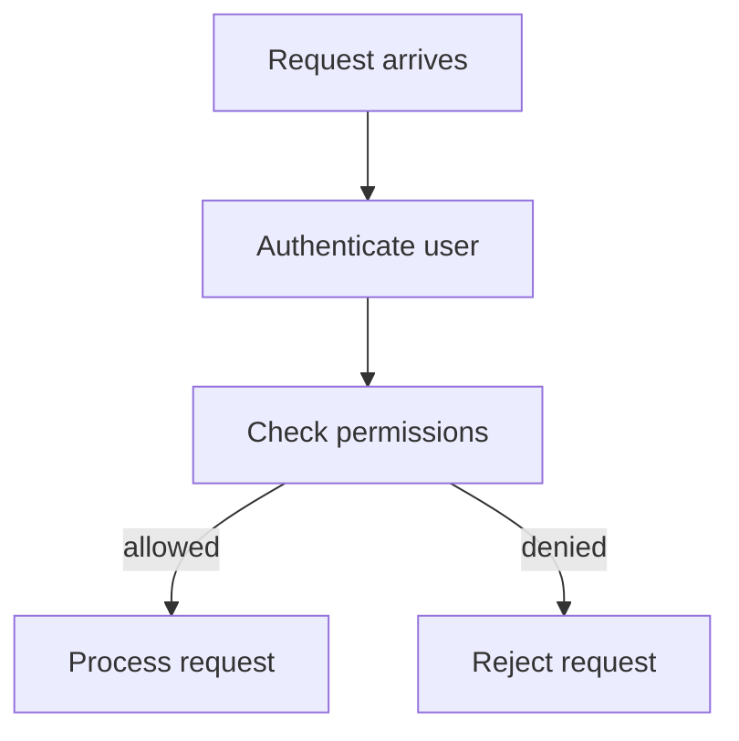

# OWASP Top 10

The OWASP Top 10:2021 highlights common and impactful web application security risks.
It helps teams focus on patterns that may lead to compromise, data exposure, or broken business logic.
Use the category names as review guidance, then verify the actual code path and impact.

## A01. Broken access control
This occurs when a user reaches data or actions outside their allowed scope.
Typical causes include missing authorization checks, insecure direct object references, and unchecked admin routes.
### Review focus
- Confirm the authenticated user is known.
- Check role, ownership, and policy enforcement.
- Prevent unauthorized reads, writes, or admin actions.

## A03. Injection
Injection happens when untrusted input is interpreted as code, SQL, shell content, or another executable format.
The most common cases are SQL injection, command injection, and unsafe template rendering.
### Review focus
- Validate input at the boundary.
- Use parameterized queries and safe APIs.
- Never concatenate user-controlled strings into executable logic.

## A02. Cryptographic failures
Weak crypto or poor key management exposes secrets and sensitive data.
Common issues include hard-coded credentials, weak hashing, insecure TLS settings, and missing secret rotation.
### Review focus
- Use approved libraries and strong algorithms.
- Protect secrets in secure stores or environment variables.
- Review certificate, token, and key handling.

## A05. Security misconfiguration
This includes overly broad permissions, debug exposure, default credentials, and poor deployment settings.
### Review focus
- Remove unnecessary services and endpoints.
- Lock down headers, permissions, and environment settings.
- Review production defaults before release.
## A04. Insecure design
Insecure design means a system lacks controls that should exist in its architecture or business workflow.
Threat modeling and abuse-case analysis help reveal risks before implementation.
### Review focus
- Check whether sensitive workflows have explicit security requirements.
- Review abuse cases, limits, and failure behavior.

## A06. Vulnerable and outdated components
Unsupported or vulnerable libraries can expose an application to known attacks.
Track component versions, advisories, and end-of-life dates.
### Review focus
- Update vulnerable packages to supported patched versions.
- Remove dependencies and features the application does not need.

## A07. Identification and authentication failures
Weak identity checks or session handling may let attackers impersonate users.
Protect login, recovery, multi-factor, and session lifecycle flows.
### Review focus
- Rate-limit authentication attempts and protect recovery flows.
- Use secure session creation, rotation, expiry, and invalidation.

## A08. Software and data integrity failures
Untrusted updates, build artifacts, or serialized data can alter application behavior.
Use trusted sources and verify integrity across build and delivery steps.
### Review focus
- Protect deployment pipelines and dependency sources.
- Validate signed or serialized data before accepting it.

## A09. Security logging and monitoring failures
Insufficient logs or alerts can delay detection and incident response.
Record security-relevant events while protecting sensitive values.
### Review focus
- Log authentication, authorization, and important state changes.
- Alert on suspicious activity and test that monitoring works.

## A10. Server-side request forgery
SSRF occurs when a server fetches a URL influenced by an untrusted caller.
An attacker may target internal services or cloud metadata endpoints.
### Review focus
- Allow only required protocols, hosts, and ports.
- Block private, loopback, link-local, and redirected destinations.

## Example
A user calls `/orders/42` and the server returns a record without checking whether that user owns the order or has permission to view it.
This is broken access control and should be fixed by enforcing authorization in the application logic before the record is returned.

## Flowchart

## Review checklist
- Verify identity and authorization.
- Check for injection points in queries, commands, and templates.
- Review crypto and secret handling.
- Inspect configuration and deployment defaults.
- Map the issue to OWASP or CWE when reporting it.

## Key takeaway
OWASP is useful because it gives a shared language for the most common system risks. Reviewers can classify issues faster and recommend relevant controls with less ambiguity.
