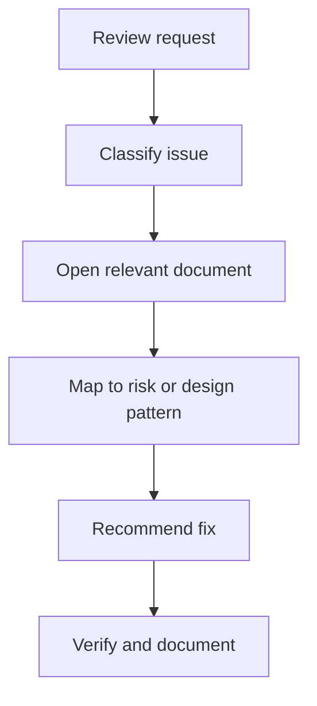

# Knowledge Base

This folder is a compact reference library for secure code review, static analysis, and maintainability checks.
It gives the AI assistant a practical set of documents that can be used during review, remediation planning, and issue classification.

## Purpose
The knowledge base helps answer four common questions:
- Is the code secure?
- Is the code readable and maintainable?
- Is the design fragile or high-risk?
- Which guidance best matches the observed issue?

## Included documents
- OWASP Top 10: web security risks and common safeguards
- Secure coding standards: validation, secrets, auth, and safe data access
- Clean code: naming, clarity, and maintainability
- Code smells: recurring design problems and technical debt patterns
- CWE: standard weakness categories for issue classification
- SpotBugs: static-analysis patterns such as nulls, races, leaks, and bad loops
- Code review playbook: a repeatable review workflow
- RAG indexing guide: retrieval advice for AI-powered review workflows

## Recommended usage flow
1. Identify the type of issue: security, maintainability, logic bug, or static-analysis warning.
2. Match the issue to a category such as OWASP, CWE, code smell, or API misuse.
3. Read the relevant document and compare it to the code path under review.
4. Recommend the smallest safe fix and verify it with tests, evidence, or code review checks.

## Example
A login endpoint builds SQL from a raw username value.
The reviewer should classify this as an injection issue, connect it to the SQL injection guidance, and recommend parameterized queries plus validation.

## Flowchart

## Review checklist
- Confirm the issue is real and reproducible.
- Trace the data flow from input to output.
- Check auth, validation, and trust boundaries.
- Map the issue to OWASP, CWE, or a static-analysis rule when relevant.
- Explain the root cause and propose a safe fix.

## Key takeaway
A useful knowledge base is not long for the sake of length. It is clear, relevant, and directly usable during review.
