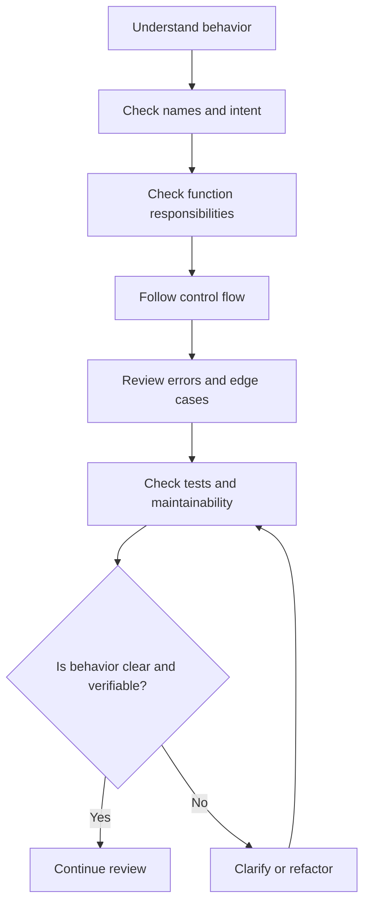

# Clean Code

Clean code is easy to read, test, and change without guesswork.
It communicates intent and helps developers understand behavior before editing it.
Readable code lowers review effort and reduces accidental defects.
It is about choosing a simple structure that makes behavior clear.

## Meaningful names
Choose names that tell readers what a value represents or an operation does.
Prefer business intent over abbreviations or vague labels such as `data` or `temp`.
Use names consistently so related concepts are easy to recognize.
For booleans, use question-like names such as `isAuthorized` or `hasAccess`.
For functions, choose a verb that describes the observable action.

## Focused functions
A function should have one clear responsibility and a name that matches it.
If it validates, saves, formats, and notifies, separate those responsibilities.
Small focused functions are easier to test and safer to reuse.
Keep related operations together when separation would obscure the main flow.

Pass only the values a function needs; avoid long, confusing parameter lists.
## Clear control flow
Prefer a visible main path over deeply nested conditions.
Use guard clauses to handle invalid or exceptional cases early.
Keep conditions simple; name a complex condition when it represents a rule.
Do not hide important side effects inside conditions or chained expressions.
Preserve the required order of validation, authorization, and side effects.

## Avoid duplication thoughtfully
Repeated rules can drift when one copy changes and another is forgotten.
Share logic when behavior and reasons for change are genuinely the same.
Keep important business rules and validation policies in one clear place.

## Handle errors honestly
Make failures visible to the caller or a defined recovery mechanism.
Do not catch an exception and continue as if the operation succeeded.
Use specific exceptions when callers can take a useful action.
Log useful context without exposing credentials or private data.
Choose defaults deliberately; do not turn invalid state into silent success.

## Useful comments
Explain why a decision exists, rather than narrating obvious code.
Document assumptions, constraints, and non-obvious trade-offs.
Update comments when behavior changes so they do not mislead readers.
Prefer clarifying code over adding a comment that restates it.

## Design for testing
Keep business rules separable from external effects when that improves testability.
Test boundary values, failure paths, and permissions as well as successful cases.
Use descriptive test names to show the behavior and condition being checked.

## Example: clarify an update operation
```java
// Before: unclear name, silent rejection, no result
void run(Profile p, User u) {
    if (p != null && u != null && u.canEdit(p)) repository.save(p);
}
```
The method name does not explain its purpose or its outcome.
If the condition fails, the caller cannot distinguish rejection from success.
```java
// After: clear intent and explicit outcomes
UpdateResult updateProfile(Profile profile, User actor) {
    if (profile == null) return UpdateResult.notFound();
    if (!actor.canEdit(profile)) return UpdateResult.forbidden();
    repository.save(profile);
    return UpdateResult.updated();
}
```
The improved version communicates its intent and returns a useful result.
In production code, also define behavior when `actor` can be absent.
The example assumes persistence failures are reported by the repository.

## Clean-code review flow


## Review checklist
- Do names reveal the meaning and purpose of values and operations?
- Does each function have a focused responsibility?
- Can readers follow the main path without tracing many branches?
- Are validation, authorization, and side effects ordered correctly?
- Is shared logic genuinely shared rather than merely similar?
- Are failures reported instead of silently ignored?
- Do comments explain assumptions and important reasons?
- Can tests verify success, invalid input, and relevant failure paths?

## Key takeaway
Clean code makes intent visible and behavior predictable.
Prefer small improvements that preserve behavior and make future changes safer.
