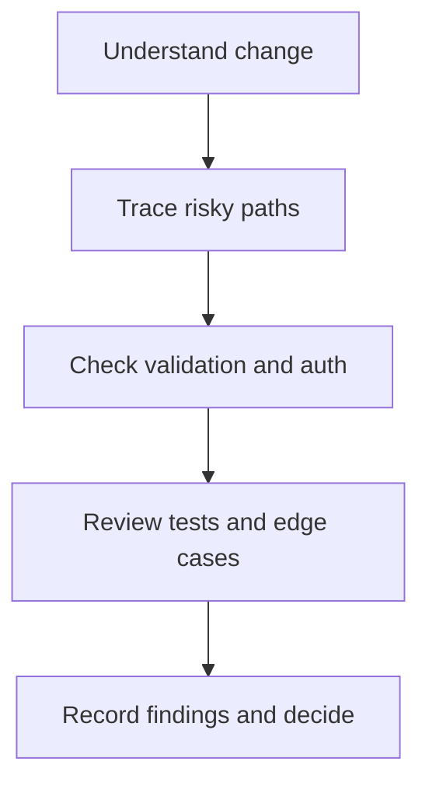

# Code Review Playbook

A code review should be structured, evidence-based, and useful to the author. The goal is not only to find defects, but to identify risk and clear improvement paths.

## Review objective
Reviewers should confirm whether the change is correct, safe, understandable, and testable.

## Review flow
1. Read the change and understand the requested behavior.
2. Trace the data flow from input to output.
3. Check security controls such as validation, auth, and safe error handling.
4. Review tests, edge cases, and failure paths.
5. Record findings with evidence and a clear recommended fix.

## High-quality findings
A strong finding usually includes:
- What the issue is
- Why it matters
- Where the risk appears
- What action should be taken next

## Severity guidance
- Critical: likely direct compromise, data loss, or severe exploitability
- High: strong likelihood of significant impact
- Medium: risky under specific conditions
- Low: mostly quality, clarity, or maintainability improvement

## Example
Finding: an API accepts a user-supplied ID and fetches records without checking ownership or role.
Impact: unauthorized read or modification of another user's data.
Fix: enforce authorization before returning or mutating the record and add a test for the unauthorized case.

## Flowchart

## Review checklist
- Did the reviewer understand the change intent?
- Were trust boundaries and data flows inspected?
- Were auth, validation, and error paths checked?
- Were findings specific and actionable?
- Was the decision based on evidence and risk?

## Key takeaway
A good review turns a rough code change into a safer, clearer, and better-validated result.
