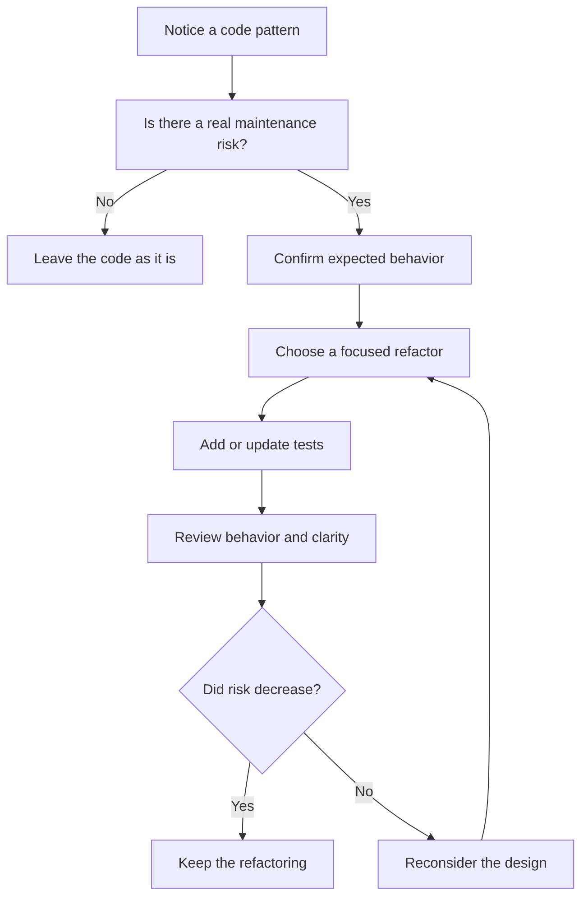

# Code Smells

Code smells are patterns that may signal weak design, confusing logic, or rising maintenance cost.
A smell is not automatically a bug; it is a reason to inspect the code and its context.
The goal is not to remove every unusual pattern, but to make future changes safer and clearer.
Refactor in small steps, preserve behavior, and add tests around important outcomes.

## 1. Duplicate logic
The same rule or behavior is copied into multiple methods, files, or services.
Find the actual shared rule and place it in a well-named helper or domain service.

```java
// Repeated checks in several controllers often drift.
if (email == null || !email.contains("@")) { ... }
```

Move common email validation to a shared validator and test its boundary cases.

## 2. Long method
A method is hard to understand because it performs many different steps.
Extract focused steps when each has a meaningful name and can be understood alone.

## 3. Large class
A class that owns unrelated behavior tends to become difficult to test and modify.
Separate cohesive responsibilities, such as report formatting from report storage.

## 4. Feature envy
A method may repeatedly read another object's data to perform that object's work.
Consider moving the operation to the object that owns the relevant data.

## 5. Primitive obsession
Many raw strings, numbers, or booleans may represent a domain concept.
Use a small value object when it protects meaningful invariants.

## 6. Long parameter list
Many parameters make a function difficult to call and easy to misuse.
Group related values into a request or domain object when they form one concept.

## 7. Shotgun surgery
A single policy change requires edits across many unrelated files.
Centralize the rule or make ownership explicit, then update focused tests.

## 8. Dead code
Unused branches, fields, methods, and commented-out blocks add noise.
Remove obsolete code through version control rather than keeping it commented out.

## 9. Deeply nested conditionals
Many nested branches make it difficult to identify the main path and edge cases.
Use guard clauses or extract a named decision when that improves clarity.
Do not flatten logic if the result becomes a confusing chain of boolean expressions.

## 10. Magic values
Unexplained numbers or strings hide their meaning and make changes error-prone.
Give domain values meaningful constants or represent them with an appropriate type.

```java
if (retryCount > 3) { stop(); }
```

If three is a policy limit, define it as `MAX_RETRY_ATTEMPTS` and explain its source.

## Example: remove duplicated validation

One controller allows 80 characters while another allows 100.
This mismatch can produce inconsistent behavior for the same user action.
Extract a shared validator with one documented length rule.
Keep controller-specific authorization and response behavior in the controllers.

## Safe refactoring process
1. Identify the repeated or confusing pattern and its actual impact.
2. Choose a small refactoring that improves one clear responsibility.
3. Refactor without mixing unrelated feature changes.
4. Run focused tests and review the diff for behavior changes.

## Flowchart: evaluating a smell


## Review checklist
- What specific future change or defect does the pattern make more likely?
- Are responsibilities and data ownership clear?
- Can the refactor preserve current behavior?
- Are tests covering relevant success and failure cases?
- Is the proposed abstraction simpler than the code it replaces?

## Key takeaway

Treat code smells as clues, not automatic defects.
Refactor when the change makes intent clearer and reduces a real maintenance risk.
