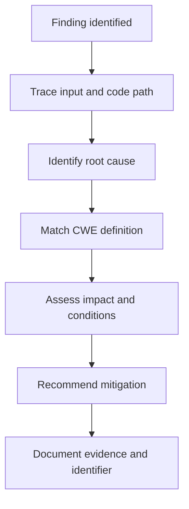

# CWE Reference

CWE means Common Weakness Enumeration.
It is a community-maintained taxonomy of software and hardware weakness types.
CWE names describe recurring root causes, not individual incidents or products.
Teams use CWE identifiers to classify findings consistently across tools and reports.
A CWE label is not a severity score and does not prove that a weakness is exploitable.
Confirm the code path, attacker control, impact, and context before reporting a finding.

## Why CWE matters
Different tools may describe the same underlying weakness in different words.
A shared CWE identifier helps reviewers compare findings and discuss remediation clearly.
It also supports trend analysis, security education, and consistent reporting.
Choose the most specific weakness that the evidence supports.
Do not force a CWE mapping when the root cause is not understood.

## Common weakness categories
### CWE-20: Improper input validation
Data is accepted without checking that it meets the rules expected by the application.
Invalid values may bypass business rules, trigger failures, or reach dangerous operations.
Validate type, range, length, format, and allowed values at trusted boundaries.
### CWE-79: Cross-site scripting
Untrusted content is included in a web page without context-appropriate output encoding.
An attacker may cause script or markup to execute in another user's browser.
Use framework output encoding and avoid unsafe HTML insertion.
### CWE-89: SQL injection
Untrusted input changes the structure or meaning of a SQL statement.
This can expose or alter data when the database account has excessive privileges.
Use parameterized queries so values remain data, not executable query syntax.
### CWE-862: Missing authorization
The application does not check whether the user is allowed to perform an action.
Authentication alone does not establish permission to read or modify a resource.
Check role, ownership, and policy on the server for every sensitive operation.
### CWE-798: Hard-coded credentials
Passwords, API keys, or tokens are embedded in source or packaged configuration.
Exposed credentials can enable unauthorized access to systems or data.
Use a secret manager, restrict access, and rotate credentials if exposed.

### CWE-502: Deserialization of untrusted data
Untrusted serialized content is converted into objects without suitable safeguards.
Unexpected types or object behavior can cause serious security or availability problems.
Prefer constrained formats and validate the expected schema and source.

### CWE-400: Uncontrolled resource consumption
An operation consumes excessive CPU, memory, connections, or other limited resources.
Repeated expensive work or unbounded input can make a service unavailable.
Apply limits, timeouts, quotas, and safe resource cleanup.
MASTER PROMPT: Complete AI Code Review & Security Analysis Agent — Milestone 1 and Remaining Project

Act as a senior full-stack developer, Python backend engineer, AI security specialist, and UI/UX designer.

My project is AI Code Review & Security Analysis Agent. I already have an existing frontend and Python backend. The UI has been redesigned, code submission works, Python and Java are automatically detected, and analysis output is displayed.

Now I need to complete the remaining tasks listed in my project proposal and implement the overall project functionality incrementally.

IMPORTANT RULES

1. First inspect the entire existing codebase, including frontend, backend, tests, configuration files, README, and existing documentation.
2. Identify the features that are already implemented and working.
3. Do not recreate the project from scratch.
4. Do not remove working functionality or overwrite existing files unnecessarily.
5. Preserve automatic Python/Java language detection, code editing, file uploads, the Analyze Code button, and the current results display.
6. Keep the existing single-page UI design. Do not add a sidebar or unnecessary side headings.
7. Implement real functionality, not mock data or placeholder buttons.
8. Work incrementally, run tests, and fix errors before proceeding to the next module.

PART 1 — COMPLETE MILESTONE 1

Task 1: Study OWASP and Secure Coding Guidelines

Create a maintainable secure coding knowledge base using trusted OWASP documentation and relevant Python and Java secure coding guidelines.

Include:

- SQL injection.
- Cross-site scripting (XSS).
- Cross-site request forgery (CSRF).
- Hardcoded passwords, API keys, and secrets.
- Insecure authentication.
- Broken access control.
- Improper input validation.
- Sensitive data exposure.
- Unsafe error handling.
- Insecure deserialization where applicable.
- Common code smells, complexity issues, and poor programming practices.

For every rule, include:

- Rule ID.
- Vulnerability or issue name.
- Description.
- Severity.
- Detection logic or guidance.
- Vulnerable code example where appropriate.
- Recommended fix.
- Trusted source reference.

Keep the rules modular so that new rules can be added later. Do not claim to detect every vulnerability.

Task 2: Complete System Architecture

Document and implement a clean architecture containing:

1. Frontend and code submission interface.
2. Python backend API.
3. Language detection and validation.
4. Code analysis engine.
5. Security vulnerability analysis.
6. Findings normalization and severity scoring.
7. Remediation recommendations.
8. Review summary generation.
9. Secure coding knowledge base and future RAG pipeline.
10. Report generation and export.

Define clear request and response schemas between frontend and backend.

Create or update an architecture document explaining the data flow, component responsibilities, API endpoints, and future multi-agent integration.

Task 3: Complete the Code Submission Module

The following features are already implemented and must be preserved:

- Direct code input.
- Python and Java code support.
- Automatic language detection.
- Source file upload.
- Analysis output display.

Inspect and test these features. Fix any incomplete cases:

- ".py" and ".java" file uploads.
- Empty input validation.
- Unsupported file extensions.
- Invalid syntax handling.
- Large input handling.
- Language detection for ambiguous code.
- Backend request failures.
- Clear Code functionality.
- Loading and error states.

Do not execute arbitrary submitted code. Use safe parsing, compilation checks in a controlled manner, or static analysis tools as appropriate.

Task 4: Build the Secure Coding Knowledge Base

Implement a working knowledge base using the existing project structure.

Requirements:

- Store structured security rules and secure coding documentation.
- Support retrieval by vulnerability type, language, and relevant keywords.
- Include OWASP guidance and source references.
- Provide fix recommendations connected to detected issues.
- Organize documents so that a future Retrieval-Augmented Generation (RAG) pipeline can use them.

If RAG is already partially implemented, inspect and extend it. If it is not implemented, prepare a modular document ingestion, chunking, embedding, retrieval, and vector-store interface.

Do not require paid API keys for basic functionality. If an external embedding model or LLM is optional, configure it through environment variables and provide a deterministic local fallback.

At the end of Milestone 1, provide a clear status report showing which of these four tasks are complete, partially complete, or still pending.

PART 2 — IMPLEMENT MILESTONE 2

1. Code Analysis Agent

Implement a real code quality analysis module that identifies:

- Code smells.
- Unused variables where supported.
- Excessive complexity where supported.
- Poor naming and maintainability issues where detectable.
- Duplicate or repetitive code patterns where practical.
- Basic design and best-practice violations.

Support Python and Java using suitable language-specific tools.

Consider tools such as Ruff, Pylint, Bandit, Semgrep, Checkstyle, or other appropriate analyzers based on the existing dependencies and supported environment.

Do not install every tool unnecessarily. Choose suitable tools, document their installation, and handle missing tools gracefully.

2. Security Vulnerability Agent

Implement a security analysis module that:

- Scans submitted code for supported vulnerability patterns.
- Identifies the affected line and code location.
- Classifies findings by vulnerability category.
- Assigns Critical, High, Medium, or Low severity where justified.
- Explains the security risk.
- Suggests a practical remediation.
- Includes a trusted rule or documentation reference.

Use established static-analysis tools when suitable and add deterministic custom rules where useful.

Do not rely exclusively on regex for complex security vulnerabilities. Clearly distinguish confirmed static-analysis findings from heuristic warnings.

3. Multi-Agent Orchestration

Implement a modular orchestration layer with separate responsibilities for:

- Code Analysis Agent.
- Security Vulnerability Agent.
- Remediation Agent.
- PR Summary Agent.
- Conversational Code Assistant.

The orchestration pipeline should:

1. Receive submitted code.
2. Validate the request and programming language.
3. Run code quality and security analysis.
4. Normalize findings into a common format.
5. Associate findings with secure coding rules.
6. Generate remediation recommendations.
7. Produce a readable review summary.
8. Return a structured result to the frontend.

Run independent analysis tasks concurrently only when safe and supported by the existing architecture.

Do not merely create five classes and claim the agents are functional. Each implemented agent must perform its stated task.

4. Validate Detection Accuracy

Create sample Python and Java files covering:

- Clean code.
- Syntax errors.
- Code quality problems.
- Hardcoded secrets.
- SQL injection examples.
- Other supported security vulnerabilities.

Add automated tests that check detection results, line numbers where available, severity, remediation guidance, and false-positive handling.

Use synthetic test credentials only. Never use real secrets.

PART 3 — IMPLEMENT THE REMAINING PROJECT MODULES

Implement the following features in a sensible order after the earlier modules work.

Module A: Findings Display and Severity Scoring

Create a consistent finding format containing:

- Finding ID.
- Title.
- Category.
- Severity.
- Programming language.
- File name.
- Line number.
- Explanation.
- Evidence or affected code snippet.
- Recommended fix.
- Corrected example where appropriate.
- Rule ID and source reference.

Display actual backend results. Make severity filters and finding details interactive.

Calculate summary cards from the returned findings rather than hardcoding numbers.

Module B: Remediation Agent

For each finding:

- Explain the problem in simple language.
- Explain why it matters.
- Suggest a secure fix.
- Provide corrected code when it can be done reliably.
- Preserve the original code until the user chooses to apply a suggested fix.
- Explain when a fix requires manual review.

Do not silently modify submitted code or invent a guaranteed fix.

Module C: PR Summary Agent

Generate a structured review summary containing:

- Overall code quality assessment.
- Total findings by severity.
- Important security risks.
- Main maintainability issues.
- Recommended fixes in priority order.
- Remaining concerns and limitations.

Keep the summary readable and suitable for a pull request or project report.

Module D: RAG-Powered Conversational Code Assistant

Implement a follow-up question interface where users can ask:

- Why was this issue detected?
- How can I fix it?
- What is SQL injection?
- Why is this code insecure?
- Which secure coding guideline applies?

Retrieve relevant content from the secure coding knowledge base and include source references.

If a real RAG pipeline already exists, complete it. Otherwise, implement a modular retrieval baseline and clearly identify which parts require embeddings or an external LLM.

Do not fabricate retrieved documents or claim that a model was used when it was not.

Module E: Report Generation and Export

Generate a structured code review report containing:

- Project or file name.
- Programming language.
- Analysis date and time.
- Analysis tools used.
- Executive summary.
- Findings and severity breakdown.
- Affected lines.
- Remediation recommendations.
- Secure coding references.
- Analysis limitations.

Provide downloadable JSON and Markdown reports, and PDF export if supported by the existing stack.

Ensure the report contains the real analysis results and does not expose secrets unnecessarily.

Module F: Review History

If appropriate for the existing application, add review history so users can revisit previous reports. Store data safely, avoid saving source code or secrets unnecessarily, and document the storage approach.

PART 4 — UI REQUIREMENTS

Preserve the existing single-page dashboard.

The main page should display:

- AI Code Review & Security Analysis Agent heading.
- Code editor.
- Upload Code button.
- Automatically detected language badge.
- Analyze Code and Clear Code buttons.
- Analysis progress and connection status.
- Compact issue summary cards.
- Security and code quality findings.
- Remediation guidance.
- Review summary.
- Report export controls.
- Follow-up assistant interface when implemented.

Keep the design professional, responsive, and visually consistent. Do not add a sidebar or unnecessary side headings.

PART 5 — BACKEND AND API RELIABILITY

Inspect the existing Python backend and frontend proxy configuration.

Verify:

- Backend startup command.
- API host and port.
- Frontend proxy target.
- Actual analysis endpoint.
- Request and response schemas.
- Exception handling.
- Useful error messages.
- Input and file-size validation.
- Dependency installation.
- Environment variable configuration.

Resolve existing startup or connection errors based on the actual code. Do not assume a particular port if the project configuration specifies another.

Never return fabricated successful results when analysis fails.

PART 6 — SECURITY REQUIREMENTS

- Never execute submitted code directly.
- Do not expose API keys, passwords, or environment variables.
- Validate file extensions and input size.
- Avoid unsafe shell command construction.
- Run static-analysis tools with safe argument handling and suitable timeouts.
- Do not claim that static analysis guarantees code security.
- Protect reports and review history from accidental secret disclosure.
- Keep external API integrations optional when possible.

PART 7 — TESTING AND DELIVERY

After implementation:

1. Run the existing tests.
2. Add tests for newly implemented functionality.
3. Run frontend linting and production build where configured.
4. Start the backend with the correct command.
5. Test the analysis endpoint with real Python code.
6. Test the analysis endpoint with real Java code.
7. Verify automatic language detection and file uploads.
8. Test clean code, invalid syntax, and supported security vulnerabilities.
9. Verify severity counts and finding details.
10. Test remediation guidance.
11. Test review summaries and report downloads.
12. Test knowledge-base retrieval and conversational responses if implemented.
13. Fix errors found during testing.
14. Update the README with installation, configuration, startup, testing, and troubleshooting instructions.

At completion, provide:

- A Milestone 1 completion checklist.
- A Milestone 2 completion checklist.
- A list of files created or modified.
- Features actually implemented.
- Tests actually run and their results.
- Any pending features or external setup requirements.
- Exact commands to start the backend and frontend.

Start by inspecting the existing codebase and preparing an implementation plan. Then implement the missing functionality incrementally, testing each module before moving on. Prioritize correctness and a working end-to-end application over creating additional files or visual placeholders.
### CWE-476: NULL pointer dereference
Code uses a pointer or reference that may not refer to a valid object.
In Java, the related failure commonly appears as a `NullPointerException`.
Check the value or enforce a clear non-null contract before use.

## How to classify a finding
1. Describe what the code does and identify the exact risky operation.
2. Trace the relevant input, state, or permission decision to that operation.
3. Identify the root cause, not only the symptom seen by the user.
4. Compare the evidence with CWE definitions and choose a specific match.
5. Note any conditions required for an attacker or user to trigger the issue.
6. Describe impact and remediation separately from the CWE identifier.
7. If multiple weaknesses are present, report distinct root causes clearly.
8. Do not report several overlapping CWE labels for one cause without explanation.

## Example: unsafe query construction
Suppose a search endpoint inserts a query parameter into SQL text.
An attacker-controlled value can change the query structure.
The root cause is unsafe construction of a SQL statement from untrusted input.
Map the weakness to CWE-89 when the evidence supports SQL injection.
Recommend parameter binding and tests using quotes and SQL metacharacters.
Do not claim data was stolen unless the evidence shows that impact occurred.

## Mapping cautions
A scanner's CWE label is a useful clue, but it may be broad or inaccurate.
Read the warning and inspect the specific source and data flow.
Do not use a CWE number as a substitute for explaining the defect.
Separate a coding weakness from its severity and practical exploitability.
Use the current official CWE descriptions when a precise mapping matters.

## Flowchart

## Review checklist
- Is the root cause supported by source-code evidence?
- Is the selected CWE specific enough but not overstated?
- Are attacker control and reachable conditions explained?
- Is the likely impact described independently of the CWE number?
- Does the remediation address the cause rather than hide the warning?
- Are tests or checks included to prevent recurrence?

## Key takeaway
CWE gives teams a shared vocabulary for software weakness root causes.
Use it to make findings consistent, but always explain the evidence and safe fix.
