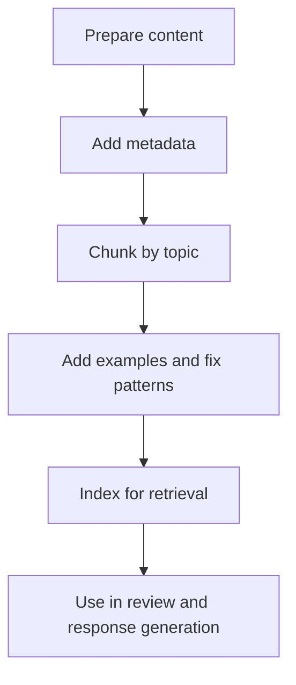

# RAG Indexing Guide

A strong retrieval setup depends on useful structure, clear metadata, and focused content. The aim is not to add more text, but to add more relevant and retrievable guidance.

## Document structure
Each document should answer a specific question, cover a focused topic, and include a few practical examples.

### Recommended format
- Title and summary
- Main concept and risk area
- Example or scenario
- Fix guidance or prevention pattern
- Review checklist

## Metadata
Metadata improves retrieval quality and ranking. Helpful fields include:
- category
- keywords
- risk level
- related frameworks like OWASP or CWE
- example scenarios

## Chunking strategy
Chunk by topic and problem, not by arbitrary length. A good chunk should map to one issue pattern and one fix pattern.

## Quality bar
The best knowledge base content is:
- concise
- actionable
- evidence-based
- easy to understand
- tied to real code review patterns

## Example
Chunk: SQL injection in login flow
Metadata: `category=security`, `tags=sql,injection,auth,owasp`
Content: root cause, risk, safe fix pattern, review checklist, example test scenario

## Flowchart

## Review checklist
- Is each document focused on one subject?
- Does it include a real example?
- Are keywords and metadata meaningful?
- Is the content easy to retrieve and easy to understand?
- Are fix and remediation steps specific enough to use in review?

## Key takeaway
Good knowledge retrieval is about signal, not volume. A well-structured, relevant document library is more useful than a large block of repetitive notes.
