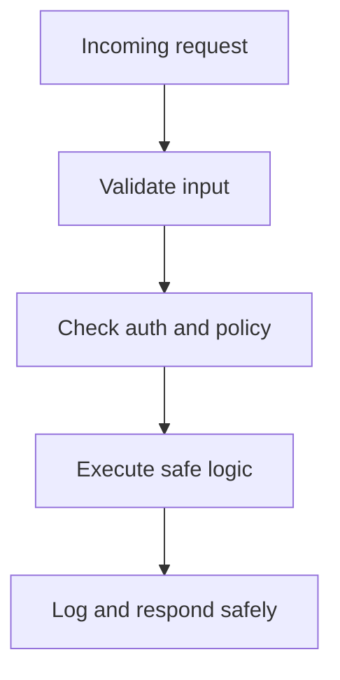

# Secure Coding Standards

Secure coding standards define the minimum expectations for safe implementation. They help prevent common vulnerabilities and make reviews more consistent.

## Input validation
Every external value should be checked before use. Validation should happen at trust boundaries, not only in the browser or UI.

### Good practice
- Check type, length, range, and format.
- Validate tokens, IDs, and uploaded content.
- Fail closed when data is missing or malformed.

## Secrets and configuration
Secrets must never be hard-coded in source files, logs, or shared config artifacts.

### Good practice
- Store secrets in environment variables or secret managers.
- Rotate keys and credentials regularly.
- Restrict service identities to least privilege.

## Data access safety
Database, file, and service access should use safe APIs that separate data from executable commands.

### Good practice
- Use parameterized queries instead of string concatenation.
- Validate file paths and external resource names.
- Avoid unsafe shell or command execution with untrusted input.

## Authorization and error handling
Authentication proves who the user is. Authorization decides what they are allowed to do.

### Good practice
- Enforce authorization in backend logic, not only in the UI.
- Avoid leaking stack traces or sensitive data in responses.
- Log useful details without exposing secrets.

## Passwords and authentication
Passwords should be verified with a dedicated password-hashing function.
Never store passwords in plain text or use fast general-purpose hashes.
Use well-maintained authentication libraries and secure session handling.
### Good practice
- Require strong controls for password reset and account recovery.
- Rate-limit repeated login attempts without enabling easy denial of service.
- Revoke sessions after logout, password reset, or suspicious activity.

## Output encoding
Data safe in one context may be dangerous when inserted into HTML, JavaScript, or a URL.
Use framework encoding for the exact output context instead of hand-built escaping.
### Good practice
- Encode untrusted text when rendering it in a browser.
- Avoid unsafe HTML insertion APIs unless content is strictly sanitized.
- Validate redirect targets and construct URLs with safe APIs.

## File and upload safety
Treat uploaded files and user-provided paths as untrusted input.
Do not trust a filename, extension, or client-provided content type as proof of safety.
### Good practice
- Generate server-side file names and restrict allowed file types and sizes.
- Store uploads outside executable web paths and apply least-privilege access.
- Prevent path traversal by resolving paths within an approved directory.

## Dependency and build safety
Third-party libraries and build processes are part of the application's attack surface.
Use maintained components and track security advisories for dependencies.
### Good practice
- Review dependency updates and remove packages that are not needed.
- Protect build credentials and verify artifacts from trusted sources.
- Keep deployment permissions scoped to the required resources.

## Tests for security behavior
Security tests should verify denial as well as successful access.
Test trust boundaries and failure cases whenever security behavior changes.
### Good practice
- Add tests for unauthorized users and malformed input.
- Verify secrets and sensitive values are absent from responses and logs.

## Example
Instead of building SQL like `SELECT * FROM users WHERE name = '" + username + "'`, use a parameterized query or ORM API that binds the username as data, not query syntax.

## Flowchart

## Review checklist
- Is input validated at the boundary?
- Are secrets stored securely?
- Are authorization checks enforced server-side?
- Are database and command calls safe?
- Are errors logged without leaking sensitive information?

## Key takeaway
The safest code is explicit, validated, and easy to reason about under failure conditions.
