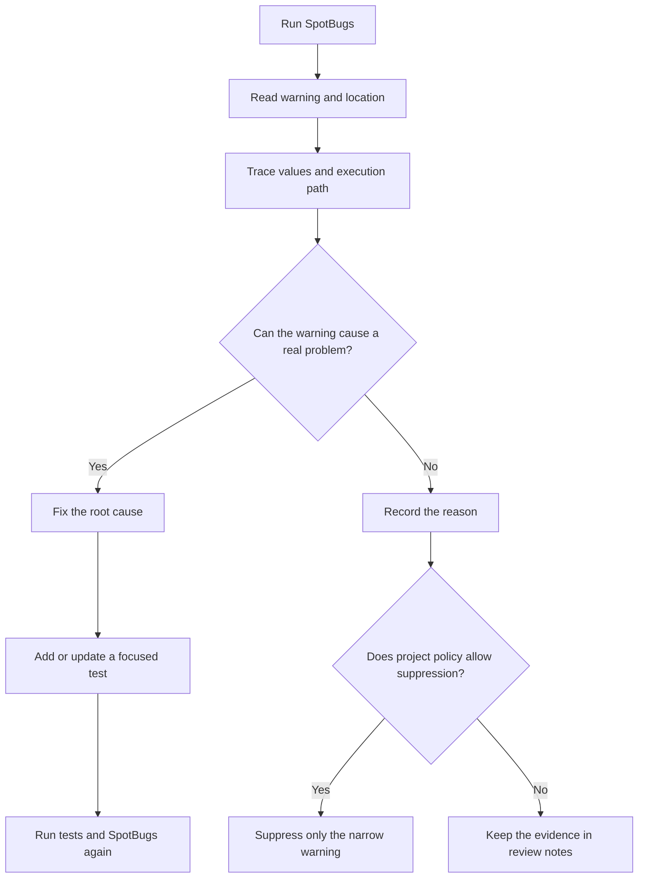

# SpotBugs and Static Analysis

SpotBugs is a static-analysis tool for Java. It examines compiled bytecode and reports patterns that may indicate defects, security risks, or code that is difficult to maintain.
It can detect suspicious behavior without running the application. This makes it useful during development and as part of continuous integration.
SpotBugs findings are warnings, not automatic proof of a bug. A reviewer must check the affected code path, inputs, and runtime conditions before deciding what to do.

## What static analysis does

Static analysis checks source or compiled code against known rules and patterns.
SpotBugs analyzes Java bytecode, so its findings can apply even when the source uses different coding styles.
The tool can catch mistakes that are easy to overlook in a manual review, such as a possible null dereference or a resource that is not closed.
It does not know every business requirement and cannot prove that an application is correct or secure.
Treat a warning as a reason to investigate, then confirm whether users can actually reach the problematic behavior.

## Why teams use SpotBugs

- Find likely defects earlier, before they reach a deployed environment.
- Apply the same baseline checks to local changes and pull requests.
- Focus manual review on code paths that deserve extra attention.
- Detect recurring patterns across a large Java codebase.
- Track whether a fix removes the underlying risk rather than hiding a warning.

## 1. Possible null dereferences

A null dereference occurs when code calls a method or reads a field from a value that may be `null`.
The result is usually a `NullPointerException`; the affected request or background job may fail.
Warnings may appear around method return values, fields, parameters, or values assigned only in some branches.

```java
String displayName = user.getProfile().getDisplayName();
```

This line assumes that both `user` and `getProfile()` return non-null objects.
If either value can be missing, the application can fail before producing a useful response.
Check the contract of each method and handle the missing-data case at the correct boundary.

```java
if (user == null || user.getProfile() == null) {
    return "Unknown user";
}
return user.getProfile().getDisplayName();
```

Avoid adding a null check without deciding what the application should do when data is absent.
A clear fallback, validation error, or explicit failure is better than silently hiding invalid state.

## 2. Resource leaks

Files, streams, sockets, database connections, and similar resources need reliable cleanup.
A leak can exhaust memory, file handles, connection pools, or operating-system resources.
Cleanup must still happen if reading, writing, or processing throws an exception.

```java
FileInputStream input = new FileInputStream(path);
readConfiguration(input);
input.close();
```

If `readConfiguration` throws, `close()` is skipped and the stream remains open.
In Java, prefer try-with-resources for resources that implement `AutoCloseable`.

```java
try (FileInputStream input = new FileInputStream(path)) {
    readConfiguration(input);
}
```

Review whether every acquired resource has a clear owner and a guaranteed cleanup path.
Do not close a resource in a helper method if ownership belongs to the caller.

## 3. Mutable state and concurrency

Shared mutable state can change between two operations that assume the value is stable.
This can cause race conditions, lost updates, inconsistent results, or intermittent failures.
The risk is higher when code runs in multiple request threads, scheduled tasks, or parallel workers.

```java
class RequestCounter {
    private int count;

    void increment() {
        count++;
    }
}
```

The increment is a read-modify-write operation; concurrent calls can overwrite each other's updates.
Use an appropriate concurrency control, such as an atomic type, synchronization, or confinement to one thread.
Choose the solution based on the required behavior rather than applying `synchronized` everywhere.
Also check whether a collection or object is exposed to callers who can modify it unexpectedly.

## 4. Values that appear unused or incorrectly handled

Some warnings point to assignments whose values are never used or to results that are ignored.
An unused result can mean the code forgot to check a success value, exception, or important return status.
It can also be intentional, so inspect the API contract and nearby logic before changing it.

```java
boolean saved = repository.save(profile);
return Response.ok(profile);
```

If `save` returns `false` when persistence fails, ignoring `saved` can report success for an unsuccessful operation.
Handle the result according to the repository contract and return an accurate response.
Do not remove a result check merely to make a static-analysis warning disappear.

## 5. Suspicious comparisons and conditions

Warnings can reveal comparisons that are unlikely to behave as intended.
Examples include comparing objects with `==` when value equality is required, or using a condition that can never be true.
For Java strings, use `equals` or `Objects.equals` when comparing contents.

```java
if (status == "READY") {
    startJob();
}
```

String literals and values loaded at runtime are not guaranteed to be the same object.
Use `"READY".equals(status)` or another null-safe value comparison.
Check boundary values such as zero, empty collections, the first and last array indexes, and maximum limits.

## 6. Error handling and exceptional paths

A finding may indicate that an exception is swallowed, ignored, or handled too broadly.
Ignoring an exception can make a failed operation look successful and leave data in an inconsistent state.
Logging an exception is not always enough; the caller may still need an error result or a retry decision.

```java
try {
    updateAccount(account);
} catch (Exception ignored) {
    // Continue
}
```

Catch only exceptions that the code can handle meaningfully.
Preserve useful diagnostic context while ensuring logs do not expose credentials or private data.
For a failed operation, make the failure visible to the caller or to a clearly defined recovery mechanism.

## How to investigate a warning

1. Read the warning text and identify the class, method, and reported source location.
2. Open the surrounding code and trace the values used at that location.
3. Identify how the method can be reached and which inputs or states are possible.
4. Check whether a missing precondition, cleanup step, or synchronization rule exists.
5. Decide whether the warning is a real defect, a safe pattern, or an unresolved uncertainty.
6. Fix the root cause when needed; do not suppress a warning only to get a clean report.
7. Add a focused test for the failure condition when the behavior can be tested.
8. Run the relevant tests and SpotBugs again to confirm the outcome.

## Classifying the result

### Real defect
The warning matches a reachable code path and can lead to a failure, incorrect result, or security exposure.
Fix the code and add a regression test when practical.

### False positive
The code is safe because of a guarantee that the analyzer cannot infer.
Document the guarantee and suppress only the narrowest finding if the project policy permits it.

### Needs investigation
The warning depends on an unclear contract or configuration.
Clarify the contract, inspect callers, or add evidence before accepting or suppressing it.

## Flowchart



## Example review finding

**Finding:** A configuration value can be `null` before the service reads a nested field.
**Impact:** Requests using an incomplete configuration can fail with a `NullPointerException`.
**Recommended action:** Validate the configuration when it is loaded, then return a clear configuration error or use an explicitly supported default.
**Verification:** Add a test for missing configuration and rerun the relevant SpotBugs analysis.

## Review checklist

- Is the warning on a reachable execution path?
- Can the input or state described by the warning occur in production?
- Is the warning about null handling, resource ownership, shared state, or ignored results?
- Does the proposed change preserve the intended behavior?
- Is failure handled visibly instead of being silently ignored?
- Has a focused test been added for the reported condition?
- Was the finding rechecked after the change?
- If the warning is suppressed, is the reason specific and documented?

## Key takeaway

SpotBugs is an early-warning tool that helps teams inspect suspicious Java patterns.
Use its findings to guide investigation, confirm the actual risk, and fix the underlying cause.
A clean report is useful, but correctness and clear evidence matter more than suppressing every warning.
